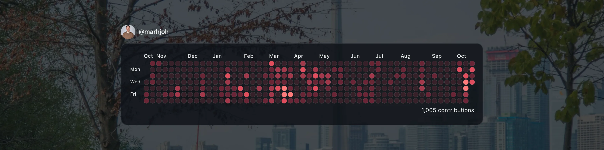
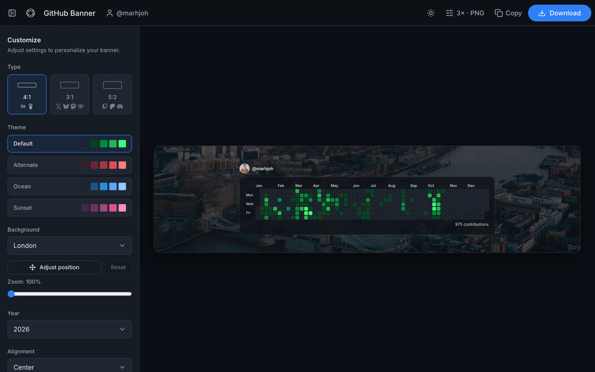
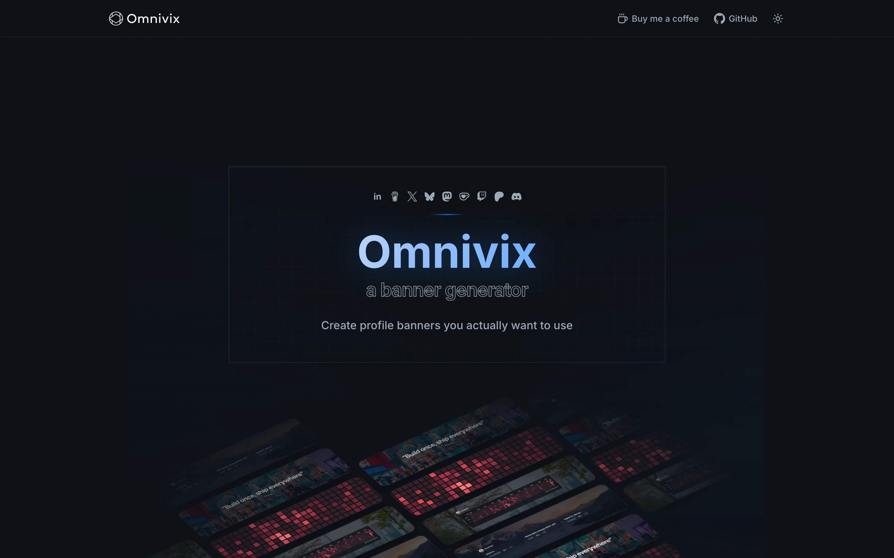
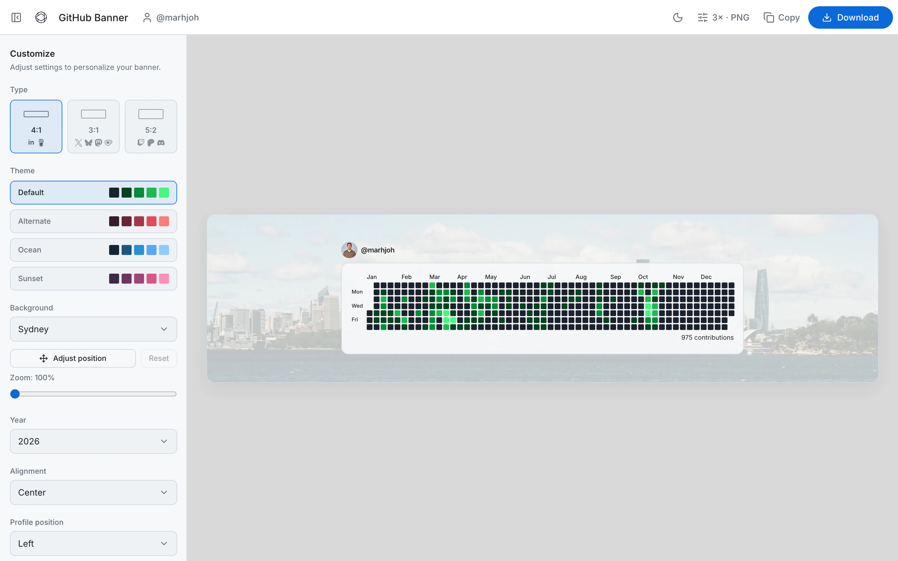

<p align="center">
  
  
</p>

<p align="center">
  Create LinkedIn, X, Bluesky, Twitch and other banners from your GitHub profile, repos, contributions or a favorite quote. Free, no sign-up.
  <br />
  <strong><a href="https://omnivix.vercel.app">omnivix.vercel.app</a></strong>
</p>

<p align="center">
  <a href="https://omnivix.vercel.app">
    
  </a>
</p>

## Features

- **Four templates**
  - **GitHub Banner:** avatar, username and contribution calendar
  - **Repos Banner:** pinned or selected repositories with languages, stars and forks
  - **Contribution Banner:** contribution heatmap
  - **Quote Banner:** quote and author
- **Four formats:** 4:1 (LinkedIn, Buy Me a Coffee), 3:1 (X, Bluesky, Mastodon, Ko-fi), 5:2 (Twitch, Patreon, Discord) and 16:9 (YouTube)
- **Backgrounds:** 14 city, nature and abstract backgrounds, an https link, or your own upload; drag and zoom to place it
- **Logo:** add your company's logo from an https link or an upload (SVG too), and drag it into place
- **Customization:** drag the content into place, color themes for the contribution grid, layout and size options, and toggles for profile photo, full name, labels and repo details
- **Export:** PNG or JPEG at up to 3× resolution, or copy the banner to the clipboard
- **Studio:** light and dark mode, on phones and desktop

## Screenshots

<p align="center">
  
</p>

<table>
  <tr>
    <th>Landing page, dark mode</th>
    <th>Studio, light mode</th>
  </tr>
  <tr>
    <td></td>
    <td></td>
  </tr>
</table>

## Getting started

You need Node.js 24.

1. **Set up pnpm** (once per machine).

   ```bash
   corepack enable
   ```

2. **Install.**

   ```bash
   git clone https://github.com/marhjoh/omnivix.git
   cd omnivix
   pnpm install
   ```

3. **Add the export browser.**

   ```bash
   pnpm exec playwright install chromium
   ```

4. **Add a [GitHub token](https://github.com/settings/tokens)** as `GITHUB_TOKEN` in `.env.local`.

   ```bash
   cp .env.example .env.local
   ```

5. **Run it.**

   ```bash
   pnpm dev
   ```

   Open http://localhost:3000.

## Documentation

- [Architecture](docs/architecture.md): rendering, export flow, saved settings and a code map
- [API](docs/api.md): the export API, studio links and routes
- [Deployment](docs/deployment.md): how the site is configured on Vercel
- [`/llms.txt`](https://omnivix.vercel.app/llms.txt): every template's settings, generated from the code

## Contributing

Contributions are welcome. See [CONTRIBUTING.md](CONTRIBUTING.md) for setup, code guidelines and how to open a pull request. To report a vulnerability, see [SECURITY.md](SECURITY.md).

## Author

- Maintained by [@marhjoh](https://github.com/marhjoh).
- See [contributors](https://github.com/marhjoh/omnivix/graphs/contributors) for everyone who has helped shape the project.

## License

[MIT](LICENSE). This covers the code, not these third-party files, which keep their own licenses:

- Background photos in `public/backgrounds/`: [Unsplash License](https://unsplash.com/license). Each photographer is credited in [`src/backgrounds/presets.ts`](src/backgrounds/presets.ts)
- Inter font in `app/fonts/` and `src/og/fonts/`: [SIL Open Font License 1.1](https://openfontlicense.org)
