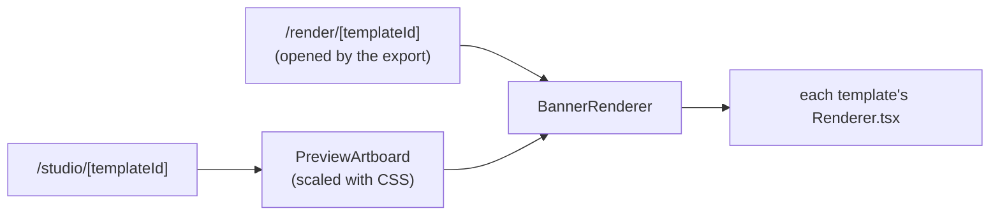
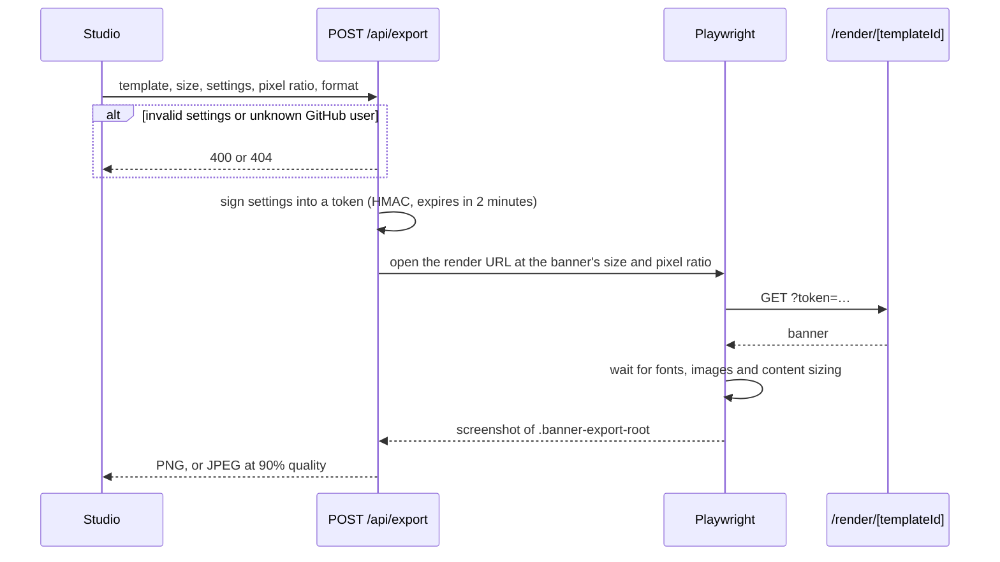

# Architecture

How Omnivix is put together. For the routes and the export API, see [api.md](api.md). For running your own copy, see [deployment.md](deployment.md).

## Project layout

```
app/                 Routes (App Router): pages, API handlers, metadata files
src/templates/       Template definitions (fields, state schema, defaults), registry and renderers
src/banner/          Building blocks the renderers share: frame, background, grid, cards, fitting
src/studio/          Studio UI: shell, sidebar, preview
src/export/          Export: token signing, render URL, Playwright capture
src/github/          GitHub GraphQL client, normalization and in-memory cache
src/landing/         Landing page sections and the shared FAQ copy
src/og/              Link-preview image rendering
src/theme/           Light/dark theme
src/backgrounds/     Background presets
src/lib/             Shared helpers: banner sizes, uploads, repository selection, site copy
src/types/           Shared types and the contribution grid themes
src/ui/              Generic UI pieces: dropdown, toast, hover highlight, icons
public/              Brand assets, background photos, landing banners
```

## Rendering

The studio preview and the exported image use the same component tree. There is no separate export-only version.



The preview renders the banner at its real export size (for example 1584 × 396) and scales it down with a CSS `transform` to fit the window (`src/studio/PreviewArtboard.tsx`, `src/studio/preview/fitScale.ts`). Layout and text wrapping are therefore the same as in the export at any window size: what you see is what you download.

## Content sizing

The GitHub, contribution and repos banners lay out their content at a fixed natural size and scale it to the banner (`src/banner/FitContent.tsx`). XL is the largest size that fits the banner minus a margin, and each step down to XS is 80% of the one above, so every size works in every format. The quote banner uses fixed type sizes instead.

## Export flow



- Settings that aren't sent use the template's defaults. Validation is in `src/export/payload.ts` (one `{ path, message }` issue per field that failed), and unknown users in `src/export/renderProblem.ts`.
- The token is stateless because the API route and the render page can run on different serverless instances.
- An uploaded or linked background doesn't go in the token: `/api/export` takes it out, and Playwright serves it to the render page from memory (`src/export/background.ts`). Links are downloaded by the server first, and only from public https addresses (`src/export/backgroundLink.ts`).
- The render page can't load anything except the app itself and GitHub profile photos.

Exports are rate limited by a Vercel Firewall rule, not in the code. See [deployment.md](deployment.md#export-rate-limit), along with which Chromium the export uses.

## GitHub data

`src/github/client.ts` queries GitHub's GraphQL API with `GITHUB_TOKEN` and normalizes the results into stable types. Results are cached briefly in server memory to stay within GitHub's rate limits (durations in `client.ts`). Nothing is stored in a database.

If the token's rate limit is reached anyway, `src/github/rateLimit.ts` stops sending requests until it resets, and the API routes and the export answer `429` with the reset time.

## Theme and saved settings

The light/dark choice is stored in the `omnivix-theme` cookie. An inline script in `<head>` sets `data-theme` before the first paint (from the cookie, or the system setting), so pages never flash the wrong theme. The studio page also reads the cookie on the server, because its banner preview picks colors in JavaScript, and the export uses the same theme for the banner's cards and text.

The studio's settings (one cookie per template) and the GitHub username are cookies too, so the studio renders them from the first paint. A built-in background or `https` link is saved with its position and zoom; an upload isn't, because it's too large for a cookie.

## Link previews and search

Titles, descriptions and Open Graph images are set per page. The landing page's "How it works" and FAQ copy lives in `src/landing/landingContent.ts`, and the visible FAQ, the JSON-LD and `/llms.txt` are all generated from it, as is the export API section of `/llms.txt` (`src/export/apiDocs.ts`).
