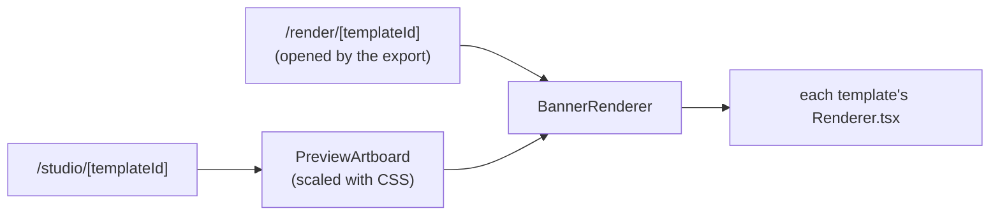
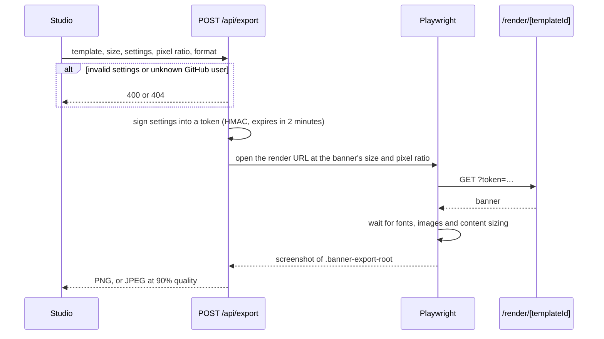

# Architecture

Omnivix is a Next.js app without a database. The studio renders each banner as a React component in the browser, and the export takes a screenshot of that same component on the server. This page explains how that works, then maps where the code lives.

## Rendering

Both the studio and the page the export screenshots render `BannerRenderer`:

The preview renders the banner at its real export size (for example 1584 × 396) and scales it down with a CSS `transform` to fit the window (`fitScale.ts`), so layout and text wrapping match the export at any window size.

## Content sizing

The GitHub, contribution and repos banners lay out their content at a fixed size, then scale it to fit the banner (`FitContent.tsx`). XL is the largest size that fits the banner minus a margin, and each step down to XS is 80% of the one above, so every size works in every format. The quote banner uses fixed type sizes instead.

## Export flow

The request fields and responses are listed in [api.md](api.md#export-api).

- The token is stateless because the API route and the render page can run on different serverless instances.
- An uploaded or linked background doesn't go in the token: Playwright serves it to the render page from memory (`background.ts`). Links are downloaded by the server first, and only from public https addresses (`backgroundLink.ts`).

The export rate limit and the Chromium version are covered in [deployment.md](deployment.md).

## Theme and saved settings

The light/dark choice is stored in the `omnivix-theme` cookie. An inline script in `<head>` sets `data-theme` before the first paint, so pages never flash the wrong theme. The studio also reads the cookie on the server, because its preview picks colors in JavaScript.

The studio's settings (one cookie per template) and the GitHub username are cookies too, so the studio renders them from the first paint. A built-in background or `https` link is saved with its position and zoom; an upload isn't, because it's too large for a cookie.

## Code map

### `app/`

Routes only: pages, API handlers and metadata files (robots, sitemap, `llms.txt`), listed in [api.md](api.md#routes). Handlers stay thin and call into `src/`.

### `src/templates/`

One folder per template with its `Renderer.tsx`. Settings and defaults are in `definitions.ts`, and `registry.ts` lists all templates.

### `src/banner/`

The pieces templates are built from: frame, contribution grid, repo cards and `FitContent.tsx`.

### `src/studio/`

The editor: sidebar, preview (`preview/`) and export button. Saved settings are read and written in `studioCookies.ts`.

### `src/export/`

Server-side export: validation (`payload.ts`), signed tokens (`export-token.ts`) and the Playwright capture (`playwright.ts`). `apiDocs.ts` generates the export API section of `/llms.txt`.

**Invariant:** the render page loads nothing except the app itself and GitHub profile photos.

### `src/github/`

GitHub GraphQL client (`client.ts`), normalization into stable types, and a short in-memory cache. When GitHub's rate limit is reached, `rateLimit.ts` stops sending requests until it resets.

### `src/landing/`, `src/og/`

The landing page, and the link-preview images. The "How it works" and FAQ copy in `landingContent.ts` is the single source for the visible FAQ, the JSON-LD and `/llms.txt`.

### `src/lib/`, `src/types/`, `src/ui/`, `src/theme/`

Shared helpers (banner sizes and platforms in `sizes.ts`), types, generic UI pieces and the light/dark theme.

### `public/`, `scripts/`

Static assets (logos, background photos, landing banners) and the [maintenance scripts](../CONTRIBUTING.md#maintenance-scripts).
