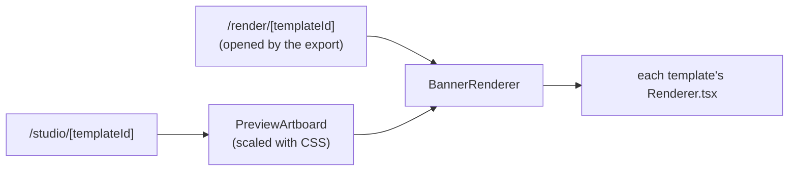
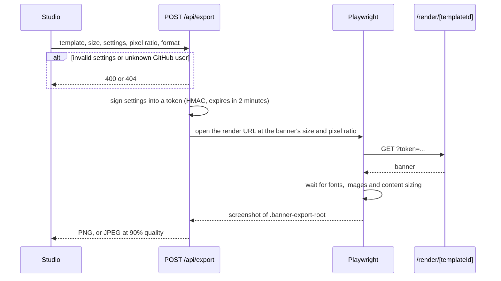

# Architecture

Omnivix is a Next.js app without a database. The export is a screenshot of the same component the studio shows.

## Rendering

The studio and the export render the same component, `BannerRenderer`:

Two kinds of scaling keep the preview and the export identical:

- **The whole banner:** the preview renders it at its real export size (for example 1584 × 396) and shrinks it with a CSS `transform` to fit the window (`fitScale.ts`). Layout and text wrapping are the same as in the export at any window size.
- **The content inside it:** the GitHub, contribution and repos banners lay out their content at a fixed size, then scale it to fit the banner (`FitContent.tsx`). XL is the largest size that fits with a margin, and each step down to XS is 80% of the one above, so every size works in every format. The quote banner uses fixed type sizes instead.

## Export flow

Two details the diagram doesn't show:

- **The token is stateless,** because the API route and the render page can run on different serverless instances.
- **Backgrounds don't go in the token.** An upload or a link is served to the render page from memory by Playwright (`background.ts`). Links are downloaded by the server first, and only from public https addresses (`backgroundLink.ts`).

See also: request fields and responses in [api.md](api.md#export-api), and the rate limit and Chromium version in [deployment.md](deployment.md).

## Theme and saved settings

Everything the visitor chooses is kept in cookies, so the server can render it on the first paint, with no flash of defaults:

- **Theme:** the `omnivix-theme` cookie. An inline script in `<head>` applies it before the page paints. The studio also reads it on the server, because the preview picks colors in JavaScript.
- **Studio settings:** one cookie per template, plus one for the GitHub username.
- **Background:** a built-in background or link is saved with its position and zoom. An upload isn't saved, because it's too large for a cookie.

## Code map

### `app/`

Routes only: pages, API handlers and metadata files, listed in [api.md](api.md#routes). Handlers stay thin and call into `src/`.

### `src/templates/`

One folder per template with its `Renderer.tsx`. Settings and defaults are in `definitions.ts`, and `registry.ts` lists all templates.

### `src/banner/`

The pieces templates are built from: frame, contribution grid, repo cards and `FitContent.tsx`.

### `src/studio/`

The editor: sidebar, preview (`preview/`) and export button. Saved settings are read and written in `studioCookies.ts`.

### `src/export/`

Server-side export: validation (`payload.ts`), signed tokens (`export-token.ts`) and the Playwright capture (`playwright.ts`). `apiDocs.ts` generates the export API section of `/llms.txt`.

**Invariant:** the render page loads nothing except the app itself and GitHub profile photos.

### `src/github/`

GitHub GraphQL client (`client.ts`), normalization into stable types, and a short in-memory cache. When GitHub's rate limit is reached, `rateLimit.ts` stops sending requests until it resets.

### `src/landing/`, `src/og/`

The landing page, and the link-preview images. The "How it works" and FAQ copy in `landingContent.ts` is the single source for the visible FAQ, the JSON-LD and `/llms.txt`.

### `src/lib/`, `src/types/`, `src/ui/`, `src/theme/`

Shared helpers (banner sizes and platforms in `sizes.ts`), types, generic UI pieces and the light/dark theme.

### `public/`, `scripts/`

Static assets (logos, background photos, landing banners) and the [maintenance scripts](../CONTRIBUTING.md#maintenance-scripts).
