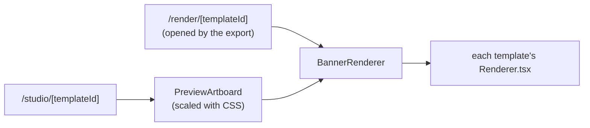
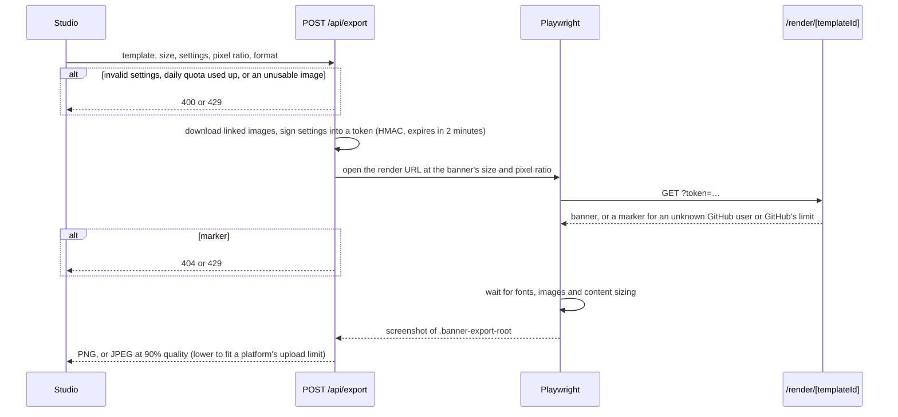

# Architecture

Omnivix is a Next.js app on Vercel that turns public GitHub data and quotes into downloadable banners. No user accounts are needed.

## Rendering

The studio and the export render the same component, `BannerRenderer`:

Two kinds of scaling keep the preview and the export identical:

- **The whole banner:** the preview renders it at its real export size (for example 1584 × 396) and shrinks it with a CSS `transform` to fit the window (`previewScale.ts`).
- **The content inside it:** the GitHub, repos, stats, tech stack, intro and contribution banners lay out their content at a fixed size, then scale it to fit the banner (`FitContent.tsx`). XL fits the banner with a margin, and each smaller size is 80% of the one above. The quote banner uses fixed type sizes instead.

YouTube and Reddit crop the banner differently on each device (`views` in `sizes.ts`). YouTube phones show the middle 1546 × 423, desktop the 2560 × 423 strip it's in, and TVs the whole image. Reddit's app shows the middle half of a 3:1 upload, with its buttons, the avatar and a fade over parts of it. The content and the logo fit the safe area, the part every device shows clearly (the phone view on YouTube), and the preview shows one view at a time.

## Export flow

Two details the diagram doesn't show:

- **The token is stateless,** because the API route and the render page can run on different serverless instances.
- **Images don't go in the token.** That covers backgrounds, logos and the intro banner's photo. Playwright serves an upload or link to the render page from memory (`images.ts`); links are downloaded first, from public https addresses only (`imageLink.ts`).

**Image URLs** (`/banner/<templateId>.png`) use the same render (`renderBanner.ts`). Their settings come from the URL, and Vercel's CDN caches the image for a day.

See also: request fields and responses for the [export API](api.md#export-api) and [image URLs](api.md#image-url), and the rate limits and Chromium version in [deployment.md](deployment.md).

## Why two renderers

Link previews are a fixed card, so `next/og` (Satori) draws them without a browser. Banners need Playwright: they measure their content in the DOM and use CSS grid, which Satori doesn't support.

## Theme and saved settings

Everything the visitor chooses is kept in cookies, so the server renders it on the first paint:

- **Theme:** the `omnivix-theme` cookie, applied by an inline script in `<head>`. The studio also reads it on the server, because the preview picks colors in JavaScript.
- **Studio settings:** one cookie per template, plus one for the GitHub username.
- **Background:** a built-in background or link is saved with its position and zoom. An upload isn't saved, because it's too large for a cookie.

## Code map

### `app/`

Routes only: pages, API handlers and metadata files, listed in [api.md](api.md#routes). Handlers stay thin and call into `src/`. Exception: `fonts.ts`, shared by the root layout and `global-error.tsx`.

### `src/templates/`

One folder per template with its `Renderer.tsx`. Settings and defaults are in `definitions.ts`, their rules in `stateSchemas.ts`, the shared types in `types.ts`, and `registry.ts` lists all templates.

### `src/banner/`

The pieces templates are built from: frame, contribution grid, repo cards and `FitContent.tsx`.

### `src/studio/`

The editor: sidebar, preview (`preview/`) and export button. Saved settings are in `studioCookies.ts`. `parseLinkSettings.ts` reads studio links, and `embedUrl.ts` builds image URLs.

### `src/export/`

Server-side export, on Effect. The export API (`route.ts`) and image URLs (`bannerImageRoute.ts`) share one render (`renderBanner.ts`), with validation in `payload.ts`, signed tokens in `exportToken.ts` and the Playwright capture in `playwright.ts`. A render stops after 45 seconds, and Chromium is closed even when it fails. `apiDocs.ts` writes the export part of `/llms.txt`.

**Invariant:** the render page loads nothing except the app itself and GitHub profile photos.

### `src/github/`

GitHub data, on Effect. `api.ts` sends each GraphQL query with `fetch` and decodes the answer with `Schema`. Its `githubRest` does the same for the REST API, for what GraphQL doesn't give our token: a following count that includes organizations, and a user's public organizations; network errors, timeouts and 5xx answers are tried once more. `client.ts` keeps the results in an Effect `Cache` per kind of data, which also shares concurrent lookups, for the times in `cacheTimes.ts` (browser-safe, as the landing FAQ quotes them). The API routes (`route.ts`) send the same cache time to Vercel's CDN and limit requests per IP (`src/lib/requestLimits.ts`, see [deployment.md](deployment.md#rate-limits)). When GitHub's rate limit is reached, `rateLimit.ts` stops sending requests until it resets. Failures are typed errors (`errors.ts`).

### `src/icons/`

Brand icons from [Simple Icons](https://simpleicons.org) for the tech stack and intro banners. Every icon's path is in the `simple-icons` package (about 5 MB), so only the server loads it (`simpleIcons.ts`). The studio gets a search list without paths (`/api/icons/catalog`, built once with the app) and the paths of the icons it shows (`/api/icons?slugs=`). The export reads them on the server.

### `src/stats/`, `src/admin/`

Usage stats, as daily counters in Upstash Redis (`stats.ts`), kept for 800 days so a year can be compared with the one before. `proxy.ts` counts page loads without cookies (`pageView.ts`). The export (`renderBanner.ts`) and every named 429 (`tooManyRequests`) count too. `statFields.ts` names the counters, and only values from fixed lists, referring sites and cleaned failure messages end up in them: no usernames, IPs, text or images. `src/admin/` is the private dashboard at `/admin`.

### `src/landing/`, `src/og/`

The landing page, the site header and footer (`SiteShell.tsx`), and the link-preview images. The "How it works" and FAQ copy in `landingContent.ts` is the single source for the visible FAQ, the JSON-LD and `/llms.txt`.

### `src/error-pages/`

What `app/not-found.tsx`, `error.tsx` and `global-error.tsx` render.

### `src/lib/`, `src/ui/`, `src/theme/`

Shared helpers (banner sizes and platforms in `sizes.ts`), generic UI pieces and the light/dark theme.

### `public/`, `scripts/`

Static assets (logos, background photos, landing banners) and the [maintenance scripts](../CONTRIBUTING.md#maintenance-scripts).
